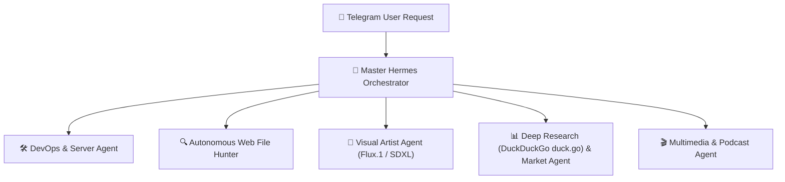

# AGENTS.md - Repository Guidelines for AI Agents

> **Standard:** Formatted according to the [agents.md](https://agents.md) open specification for AI coding assistants.
> **Project:** Amir Tools Bot (`@Game_iran_amir_bot`) & Multi-Agent Autonomous Runner
> **Owner & Admin ID:** `7243980602`
> **Repository:** `Amirjam000/amir-tools-runner`

---

## 1. Project Overview & Architecture

Amir Tools is an enterprise-grade Telegram Multi-Agent Swarm and Utility Bot built in Python. It runs continuously 24/7 on high-speed cloud infrastructure with resilient failover, instant leadership election, and multi-tier database persistence.

### Core Architecture Components
- **`host_bot_engine.py`**: Complete uncompiled source code (16,000+ lines). Contains all bot handlers, the Hermes multi-agent swarm, database sync, and media pipelines.
- **`make_encrypted_engine.py`**: Compiles and compresses `host_bot_engine.py` into `compiled_engine.py` for cloud runtime efficiency and bytecode protection.
- **`amir-tools-runner/app.py`**: The production engine executed on Ubuntu GitHub Actions runners.
- **`.github/workflows/runner.yml`**: 24/7 CI/CD runner workflow featuring a 30-minute watchdog, zero-downtime auto-relay, and automated handover.

### Triple-Database Synchronization
1. **Local SQLite (`amir_bot.db`)**: Ultra-fast local in-memory/disk cache with WAL journal mode.
2. **Neon Cloud PostgreSQL**: Global state storage for users, challenges, participants, tokens, and cluster leadership.
3. **Cloudflare D1**: Global edge database for node health, heartbeat registry, and backup failover.

---

## 2. Multi-Agent Swarm Roles & Capabilities (Full OOP ReAct Rewrite)

The bot operates on a modernized, modular ReAct Multi-Agent Swarm inside AgentContext and 
un_hermes_agent():
- **AgentContext**: Encapsulates user intent, real-time dynamic thinking, token tracking, and structured step-by-step trace generation.
- **LiveThinkingContext**: Thread-safe dynamic ticker updating 💭 Thinking\n{elapsed}s · reasoning... in real-time.
- **Unified Telegram 8.0+ UI**: Every response seamlessly outputs <blockquote expandable>{elapsed}s • ⚡ {tokens} • 💻 مراحل کار\n...</blockquote> with actual execution steps.

The bot operates on a multi-agent routing system inside `run_hermes_agent()`:



1. **Master Hermes Orchestrator:**
   - Routes natural language intents.
   - Manages live `💭 Thinking` status editing.
   - Formats outputs with Telegram expandable blockquotes:
     `<blockquote expandable>مراحل کار • 30 ⚡ • {elapsed}s 💻\n...</blockquote>`

2. **DevOps & Server Engineer Agent:**
   - Server storage manager (`SERVER_STORAGE_DIR`).
   - Downloads files directly to server disk (`/dl <url>` or natural language).
   - Manages `/server` diagnostics (CPU, RAM, NVMe disk, Telegram API ping).
   - Handles `/server_files` file lists and `/clean_server` disk cache purger.
   - High-precision ICMP ping diagnostics (`execute_network_ping`).
   - Terminal access (`/sh <cmd>`), strictly whitelisted to `OWNER_ID = 7243980602`.

3. **Autonomous Web File Hunter Agent (`autonomous_find_file_candidates`):**
   - Discovers files across the web without explicit URLs.
   - Intelligently recognizes formats: PDF, MP3, APK, ZIP, EPUB, DOCX, EXE.
   - Scrapes web search results, media portals (UpMusic/MusicFa), and Internet Archive.
   - Crawls landing pages for direct download links.
   - Downloads via streaming chunked connection to NVMe server storage, computes SHA256, and dispatches directly as a Telegram document (`send_document`) if <= 49.5 MB.

4. **Visual Artist Agent (`handle_image_generation_request`):**
   - High-end prompt upscaling using `craft_refined_image_prompt()` and `fast_translate_and_enhance_prompt()`.
   - Multi-model rendering: Flux.1 Schnell, Flux Realism, and SDXL Lightning.
   - Inline keyboard for switching styles (Photorealistic 8K, Anime, Cyberpunk, 3D Pixar).

5. **Deep Research (DuckDuckGo duck.go) & Financial Agent:**
   - Live market rates: Dollar (Free Market, Nima, Remittance), Euro, Gold, Coins, and Crypto.
   - Live web search and news synthesis with clickable source citations.

6. **Multimedia Agent:**
   - High-speed YouTube audio/video direct streaming.
   - Instagram Reels & posts downloader.
   - Visual Podcast Studio (`/podcast`).

---

## 3. Essential Development & Deployment Commands

Always follow this exact workflow when modifying bot code:

```bash
# 1. Edit host_bot_engine.py
# (Always verify syntax first)
python -m py_compile host_bot_engine.py

# 2. Compress & Compile into compiled_engine.py
python make_encrypted_engine.py

# 3. Copy to GitHub runner repository
cp compiled_engine.py amir-tools-runner/app.py

# 4. Commit & Push to GitHub (triggers instant deployment)
cd amir-tools-runner
git add app.py .github/workflows/runner.yml AGENTS.md
git commit -m "feat: your concise commit message"
git push origin main
```

---

## 4. Hard Guardrails & Security Rules ("Never Do This")

1. **NO Hardcoded Un-Split Secrets:**
   - Never commit raw un-split Personal Access Tokens (`gho_...`) or Cloudflare tokens directly in plaintext files committed to git.
   - Always split tokens (e.g. `"gho_" + "BAVV11p..."`) or retrieve them via `os.environ.get("RUNNER_PAT")` to avoid GitHub Push Protection rejections (`GH013`).
2. **Terminal & Shell Command Isolation:**
   - Commands `/sh`, `/term`, `/cmd`, `/exec` are strictly restricted to `OWNER_ID = 7243980602`. Regular users must NEVER have access to system execution.
3. **Character Limits for Groups:**
   - Regular users in group chats are limited to 100 characters per request. `OWNER_ID` has unlimited characters.
4. **Encoding & Line Endings:**
   - Preserve UTF-8 encoding across all Persian text strings.
   - On Windows, ensure `sys.stdout.reconfigure(encoding='utf-8')` is used in CLI scripts to prevent `cp1256` charmap errors.
5. **Zero-Downtime Runner Handover:**
   - Do NOT remove `if: always() && !cancelled()` from `.github/workflows/runner.yml`.
   - Do NOT re-introduce the 300-second stability delay for `GITHUB_ACTIONS == "true"`; the runner must claim leadership immediately on second 1.

---

## 5. Telegram Formatting & UI Standards

- **Expandable Quotes:** Use `<blockquote expandable>مراحل کار • 30 ⚡ • {elapsed}s 💻\n...</blockquote>` for Chain-of-Thought (CoT) and tool traces. The first line must match the collapsible header format.
- **Live Thinking Bubbles:** Send `💭 Thinking\n1s · reasoning...` initially and edit it in-place to avoid chat clutter.
- **Typography:** Use `<code>...</code>` for IPs, hashes, filenames, and commands. Bold `<b>...</b>` for labels and key numbers.
- **Link Previews:** Use `link_preview_options={"is_disabled": True}` on links to keep output clean.

---

*Authored for Antigravity, OpenAI Codex, Cursor, Claude Code, and all agentic AI systems.*
